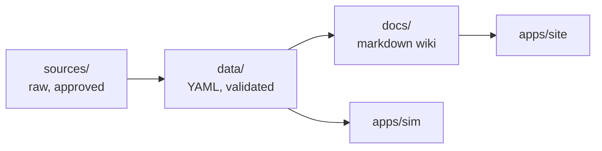

# Open Civic

Open-source archive, wiki and simulator for **1990-2002 Honda Civics** (BR, JP and US markets): maintenance, longevity, electrical, tuning and model identification.

> **Docs:** https://ej8civic.github.io/open-civic/ <br>
> **Simulator:** https://ej8civic.github.io/open-civic/sim/ (coming in Phase 3)

<br>

## Scope

| In scope | Not in scope |
|---|---|
| Civic EJ1 (Gen 5), EK / EJ6-EJ8 / EM1 (Gen 6), EK9 Type R, ES (2001-2002) | Other Hondas, other markets |
| Maintenance, longevity, electrical, pinouts, tuning (rusEFI etc.) | Copyrighted manual scans, cracked or paid tunes |
| Specs restated from official manuals, with page citations | Emissions-defeat instructions |

<br>

## How it works



- **`sources/`**: raw material plus [`registry.yaml`](sources/registry.yaml). Every source is approved before use. Copyrighted files stay in git-ignored `sources/private/`.
- **`data/`**: one copy of each fact (specs, pinouts, intervals). The docs and the simulator both read it.
- **`docs/`**: short wiki pages, one task per file. Tables are generated from `data/`.
- **`schemas/`**: JSON Schema for the data and the page frontmatter.
- **`tools/`**: the validator and table generator.

<br>

## Docs map

| Folder | Topic |
|---|---|
| [`00-start-here`](docs/00-start-here) | How to use this wiki, safety |
| [`10-identify`](docs/10-identify) | VIN, chassis and engine codes, market differences |
| [`20-models`](docs/20-models) | Per generation and trim |
| [`30-engines`](docs/30-engines) | D-series, B-series |
| [`40-maintenance`](docs/40-maintenance) | Oil, brakes, lights, wheels, alignment... |
| [`50-longevity`](docs/50-longevity) | Making it last 500k+ miles |
| [`60-electrical`](docs/60-electrical) | ECU pinouts, harness, fuses, head unit |
| [`70-chassis`](docs/70-chassis) | Suspension, coilovers, wheels |
| [`80-tuning`](docs/80-tuning) | rusEFI, chipping, swaps |
| [`90-known-issues`](docs/90-known-issues) | Chronic factory problems |
| [`reference`](docs/reference) | Glossary, torque and fluid tables |

<br>

## Develop

```sh
npm install
npm run gen       # regenerate tables in docs from data/
npm run check     # what CI runs: tables up to date + schemas + source citations
npm run site:dev  # docs site at http://localhost:4321/open-civic/
```

The site (`apps/site`, Astro Starlight) reads `docs/` directly. Pushing to `main` deploys it to GitHub Pages.

Large files: `git lfs pull --include="sources/public/<folder>/*"`. Clones skip LFS by default.

Upstream repos (rusEFI, Proteus adapters, OBDb...) are submodules in `sources/repos/`:
`git submodule update --init --depth 1`. rusefi is opt-in, see [sources/README.md](sources/README.md).

<br>

## License

- Code: [MIT](LICENSE)
- Docs and data: [CC BY-SA 4.0](LICENSE-DOCS.md)
- Third-party sources: see [NOTICE.md](NOTICE.md)

Not affiliated with Honda Motor Co. Community documentation; use at your own risk.
