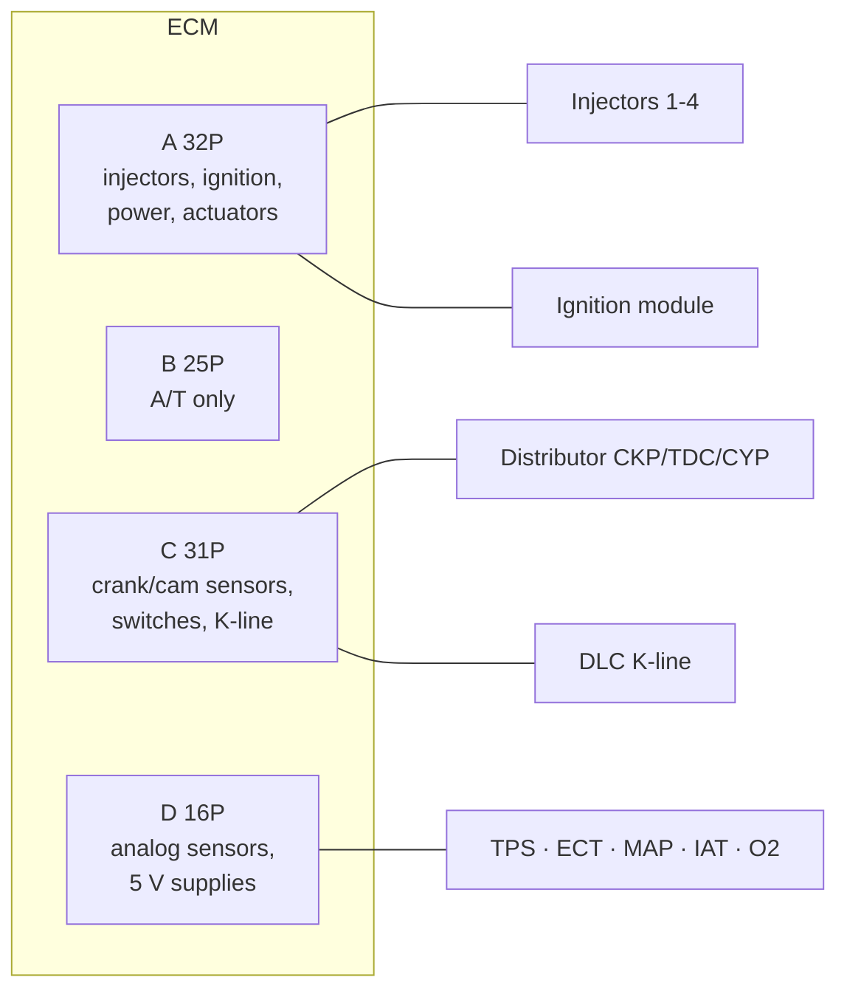

# OBD2A ECM pinout ('96-'98)

Pin map for the engine computer: use it for diagnosis, harness repair, or wiring a standalone ECU (rusEFI Proteus OBD2A adapter).

> **Applies to:** EJ6 · EJ7 · EJ8 · '96-'98 (and '99-'00 D16Y5 M/T) · US  
> **Difficulty:** 3/5 · **Tool:** multimeter, back-probing only

 

## Context

- The ECM/PCM sits behind the right (passenger, on LHD cars) kick panel, under the carpet. The ABS unit, if fitted, must come out first (SM 11-83). Four connectors: **A (32P), B (25P), C (31P), D (16P)**. The views are from the **wire side** of the female terminals.
- **Connector B is automatic-only** (PCM). On a manual car it is not populated. That is why community pinouts often show B as empty.
- Measure by **back-probing** with the connector plugged in. Never push probes into the terminal face; it spreads the contacts.
- '99-'00 models (except D16Y5 M/T) use a different arrangement, on the pages right after these in the manual. That will be a separate page.
- "Only on" lists Honda's footnote conditions. An empty cell means the pin is used on every version.

 

## Connector A (32P)

<!-- gen:pinout data=pinouts/obd2a-ecm-96-98.yaml connector=A -->
| Pin | Abbr | Function | Wire | Expected signal | Only on |
|---|---|---|---|---|---|
| A1 | `INJ4` | No. 4 fuel injector | YEL | duty-controlled ground while running |  |
| A2 | `INJ3` | No. 3 fuel injector | BLU | duty-controlled ground while running |  |
| A3 | `INJ2` | No. 2 fuel injector | RED | duty-controlled ground while running |  |
| A4 | `INJ1` | No. 1 fuel injector | BRN | duty-controlled ground while running |  |
| A5 | `SO2SHTC` | Secondary O2 sensor heater | BLK/WHT | key ON: 12 V; warm & running: duty controlled |  |
| A6 | `PO2SHTC` | Primary O2 sensor heater | BLK/WHT | key ON: 12 V; warm & running: duty controlled |  |
| A7 | `ESOL` | EGR control solenoid | RED | duty controlled when EGR active | CVT (D16Y5) |
| A7 | `E-EGR` | EGR valve | PNK | duty controlled when EGR active | M/T (D16Y5) |
| A8 | `VTS` | VTEC solenoid valve | GRN/YEL | low rpm: 0 V; high rpm: 12 V | D16Y5, D16Y8 |
| A9 | `LG1` | Logic ground 1 | BRN/BLK | < 1.0 V always |  |
| A10 | `PG1` | Power ground 1 | BLK | < 1.0 V always |  |
| A11 | `IGP1` | ECM power source 1 | YEL/BLK | key ON: 12 V; key OFF: 0 V |  |
| A12 | `IACV` | Idle air control valve | BLK/BLU | duty controlled while running | Except A/T and D16Y7 |
| A13 | `IACVN` | IAC valve negative side | ORN | duty controlled while running | A/T and D16Y7 |
| A14 | `IACVP` | IAC valve positive side | BLK/BLU | duty controlled while running | A/T and D16Y7 |
| A15 | `PCS` | EVAP purge control solenoid | RED/YEL | coolant < 68 °C: 12 V; above: duty controlled |  |
| A16 | `FLR` | Fuel pump relay | GRN/YEL | 0 V for 2 s after key ON, then 12 V |  |
| A17 | `ACC` | A/C clutch relay | BLK/RED | compressor ON: 0 V; OFF: 12 V |  |
| A18 | `MIL` | Malfunction indicator lamp | GRN/ORN | MIL ON: 0 V; OFF: 12 V |  |
| A19 | `ALTC` | Alternator control | WHT/GRN | warm, running: 12 V; small load while driving: 0 V | USA model |
| A20 | `ICM` | Ignition control module | YEL/GRN | key ON: 12 V; running: ~10 V (rpm dependent) |  |
| A22 | `LG2` | Logic ground 2 | BRN/BLK | < 1.0 V always |  |
| A23 | `PG2` | Power ground 2 | BLK | < 1.0 V always |  |
| A24 | `IGP2` | ECM power source 2 | YEL/BLK | key ON: 12 V; key OFF: 0 V |  |
| A25 | `VREF` | Reference voltage to TCM | WHT/RED | key ON: ~5 V | A/T (D16Y8) |
| A27 | `FANC` | Radiator fan relay | GRN | fan running: 0 V; stopped: 12 V | USA model |
| A28 | `2WBS` | EVAP bypass solenoid | BLU | key ON: 12 V | '96 D16Y8 coupe, '97 D16Y8 (coupe all, sedan KL), '98 D16Y5, '98 D16Y8, '99-'00 D16Y5 M/T; '97 D16Y7 (coupe KL, sedan KL/LX), '98 D16Y7 |
| A29 | `VSV` | EVAP canister vent shut valve | LT GRN/WHT | key ON: 12 V | '96 D16Y8 coupe, '97 D16Y8 (coupe all, sedan KL), '98 D16Y5, '98 D16Y8, '99-'00 D16Y5 M/T; '97 D16Y7 (coupe KL, sedan KL/LX), '98 D16Y7 |
| A30 | `SLU` | Interlock control unit | WHT/RED | key ON + brake pressed: 12 V | CVT (D16Y5) |
<!-- /gen -->

 

## Connector B (25P), automatic only

<!-- gen:pinout data=pinouts/obd2a-ecm-96-98.yaml connector=B -->
| Pin | Abbr | Function | Wire | Expected signal | Only on |
|---|---|---|---|---|---|
| B1 | `LS-` | Linear solenoid (-) | WHT | key ON: pulses |  |
| B2 | `LS+` | Linear solenoid (+) | RED | key ON: pulses |  |
| B3 | `SHA` | Shift control solenoid A | BLU/YEL | 2nd/3rd: 12 V; 1st/4th: ~0 V |  |
| B4 | `LCB` | Lock-up control solenoid B | GRN/BLK | lock-up ON: 12 V; OFF: 0 V |  |
| B5 | `LCA` | Lock-up control solenoid A | YEL | lock-up ON: 12 V; OFF: 0 V |  |
| B8 | `ATPD3` | A/T gear position switch (D3) | PNK | in D3: 0 V; else 12 V |  |
| B11 | `SHB` | Shift control solenoid B | GRN/WHT | 1st/2nd: 12 V; 3rd/4th: ~0 V |  |
| B12 | `SLU` | Interlock control unit | WHT/RED | key ON + brake pressed: 0 V |  |
| B13 | `D4IND` | D4 indicator light | GRN/BLK | light ON: 12 V; OFF: 0 V |  |
| B14 | `NMSG` | Mainshaft speed sensor ground | WHT |  |  |
| B15 | `NM` | Mainshaft speed sensor | RED | running: pulses |  |
| B16 | `ATPR` | A/T gear position switch (R) | WHT | in R: 0 V; else 12 V |  |
| B17 | `ATP2` | A/T gear position switch (2) | BLU | in 2: 0 V; else 12 V |  |
| B22 | `NCSG` | Countershaft speed sensor ground | GRN |  |  |
| B23 | `NC` | Countershaft speed sensor | BLU | key ON, wheels turning: pulses |  |
| B24 | `ATPD4` | A/T gear position switch (D4) | YEL | in D4: 0 V; else 5 V |  |
| B25 | `ATPNP` | A/T gear position switch (N/P) | LT GRN | in N or P: 0 V; else 12 V |  |
<!-- /gen -->

 

## Connector C (31P)

<!-- gen:pinout data=pinouts/obd2a-ecm-96-98.yaml connector=C -->
| Pin | Abbr | Function | Wire | Expected signal | Only on |
|---|---|---|---|---|---|
| C1 | `CKFP` | CKF sensor (+) | BLU/RED | running: pulses |  |
| C2 | `CKPP` | CKP sensor (+) | BLU | running: pulses |  |
| C3 | `TDCP` | TDC sensor (+) | GRN | running: pulses |  |
| C4 | `CYPP` | CYP sensor (+) | YEL | running: pulses |  |
| C5 | `ACS` | A/C switch signal | BLU/RED | A/C ON: 0 V; OFF: 12 V |  |
| C6 | `STS` | Starter switch signal | BLU/ORN | cranking: 12 V; else 0 V |  |
| C7 | `SCS` | Service check signal | BRN | jumpered: 0 V; open: ~5 V or 12 V |  |
| C8 | `K-LINE` | K-line (DLC) | LT BLU | key ON: ~5 V |  |
| C9 | `TMA` | TCM data out | GRY | key ON: pulses | CVT (D16Y5) |
| C10 | `VBU` | Backup power (DTC memory) | WHT/BLU | 12 V at all times |  |
| C11 | `CKFM` | CKF sensor ground | WHT/RED |  |  |
| C12 | `CKPM` | CKP sensor ground | WHT |  |  |
| C13 | `TDCM` | TDC sensor ground | RED |  |  |
| C14 | `CYPM` | CYP sensor ground | BLK |  |  |
| C15 | `VTM` | VTEC pressure switch | BLU/BLK | low rpm: 0 V; high rpm: 12 V | D16Y5, D16Y8 |
| C16 | `PSPSW` | Power steering pressure switch | GRN | idle, wheel straight: 0 V; full lock: 12 V |  |
| C17 | `ALTF` | Alternator FR signal | WHT/RED | warm, running: 0-12 V by electrical load |  |
| C18 | `VSS` | Vehicle speed sensor | BLU/WHT | key ON, front wheels turning: 0-5 V pulses |  |
| C23 | `IP+` | HO2S pump cell (+) | BLK | key ON: ~0.5-5.3 V | M/T (D16Y5) |
| C24 | `IP-/VS-` | HO2S common | RED | warm idle: ~2.6-2.8 V | M/T (D16Y5) |
| C25 | `VS+` | HO2S cell voltage | WHT | key ON: ~7 V | M/T (D16Y5) |
| C29 | `ATPNP` | A/T gear position switch (N/P) | LT GRN | in N or P: 0 V; else 12 V | CVT (D16Y5) |
| C29 | `CLSW` | Clutch switch | RED | released: ~5 V; pressed: 0 V | M/T (D16Y5) |
| C30 | `TMB` | TCM data in | PNK | key ON: pulses | CVT (D16Y5) |
<!-- /gen -->

 

## Connector D (16P)

<!-- gen:pinout data=pinouts/obd2a-ecm-96-98.yaml connector=D -->
| Pin | Abbr | Function | Wire | Expected signal | Only on |
|---|---|---|---|---|---|
| D1 | `TPS` | Throttle position sensor | RED/BLK | closed: ~0.5 V; WOT: ~4.8 V |  |
| D2 | `ECT` | Engine coolant temp sensor | RED/WHT | key ON: ~0.1-4.8 V by temperature |  |
| D3 | `MAP` | Manifold absolute pressure | RED/GRN | key ON: ~3 V; idle: ~1.0 V |  |
| D4 | `VCC1` | MAP sensor 5 V supply | YEL/RED | key ON: ~5 V |  |
| D5 | `BKSW` | Brake switch | GRN/WHT | released: 0 V; pressed: 12 V |  |
| D6 | `KS` | Knock sensor | RED/BLU | knocking: pulses | CVT (D16Y5) and D16Y8 |
| D7 | `PHO2S` | Primary O2 sensor (S1) | WHT | WOT warm: > 0.6 V; snap closed: < 0.4 V | Except M/T (D16Y5) |
| D7 | `LABEL` | LABEL resistor | WHT | running: ~0.3-4.9 V | M/T (D16Y5) |
| D8 | `IAT` | Intake air temp sensor | RED/YEL | key ON: ~0.1-4.8 V by temperature |  |
| D9 | `EGRL` | EGR valve lift sensor | WHT/BLK | no vacuum: ~1.2 V | CVT (D16Y5) |
| D10 | `VCC2` | Sensor 5 V supply | YEL/BLU | key ON: ~5 V |  |
| D11 | `SG2` | Sensor ground 2 | GRN/BLK | < 1.0 V always |  |
| D12 | `SG1` | Sensor ground 1 (MAP) | GRN/WHT | < 1.0 V always |  |
| D13 | `SHO2SG` | Secondary O2 sensor ground | GRN/BLK |  | D16Y5, D16Y8 |
| D13 | `SHO2SG` | Secondary O2 sensor ground | RED/YEL |  | D16Y7 |
| D14 | `SHO2S` | Secondary O2 sensor (S2) | WHT/RED | WOT warm: > 0.6 V; snap closed: < 0.4 V |  |
| D15 | `PTANK` | Fuel tank pressure sensor | LT GRN | fuel cap open: ~2.5 V | '96 D16Y8 coupe, '97 D16Y8 (coupe all, sedan KL), '98 D16Y5, '98 D16Y8, '99-'00 D16Y5 M/T; '97 D16Y7 (coupe KL, sedan KL/LX), '98 D16Y7 |
| D16 | `EL` | Electrical load detector | GRN/RED | idle + parking lights: 2.5-3.5 V; + low beams: 1.5-2.5 V | USA model |
<!-- /gen -->

 

## Cross-check with the rusEFI sheet

The rusEFI "Honda Civic 1996" pinout sheet agrees with Honda on the pin functions. The factory manual fills its open questions:

| Pin | rusEFI note | Factory manual says |
|---|---|---|
| B1-B25 | empty | A/T PCM pins (shift and lock-up solenoids, gear switches, shaft speed sensors) |
| C17 | "Alternator field control, type unknown" | ALTF input, 0-12 V depending on electrical load |
| D5 | "Brake switch, please confirm" | BKSW: 0 V released, 12 V pressed |
| D4 / D10 | "5 V ref, verify" | D4 = VCC1 (MAP supply), D10 = VCC2 (other sensors) |
| C9 / C30 | "TMA/FAS", "TMB" | TCM data link, CVT (D16Y5) only |

 

## Sources

- Honda Civic 1996-2000 Service Manual, "Engine/Powertrain Control Module Terminal Arrangement", pp. 11-88 to 11-91 (`honda-sm-civic-96-00`)
- rusEFI wiki, [Honda Civic 1996](https://github.com/rusefi/rusefi/wiki/Honda-Civic-1996) (`rusefi-wiki-civic-1996`, link-only)
- Hardware: [Proteus Honda OBD2A adapter](https://github.com/rusefi/proteus-Honda-OBD2A-adapter) (`proteus-honda-obd2a`)
- Data: [`data/pinouts/obd2a-ecm-96-98.yaml`](../../data/pinouts/obd2a-ecm-96-98.yaml)
