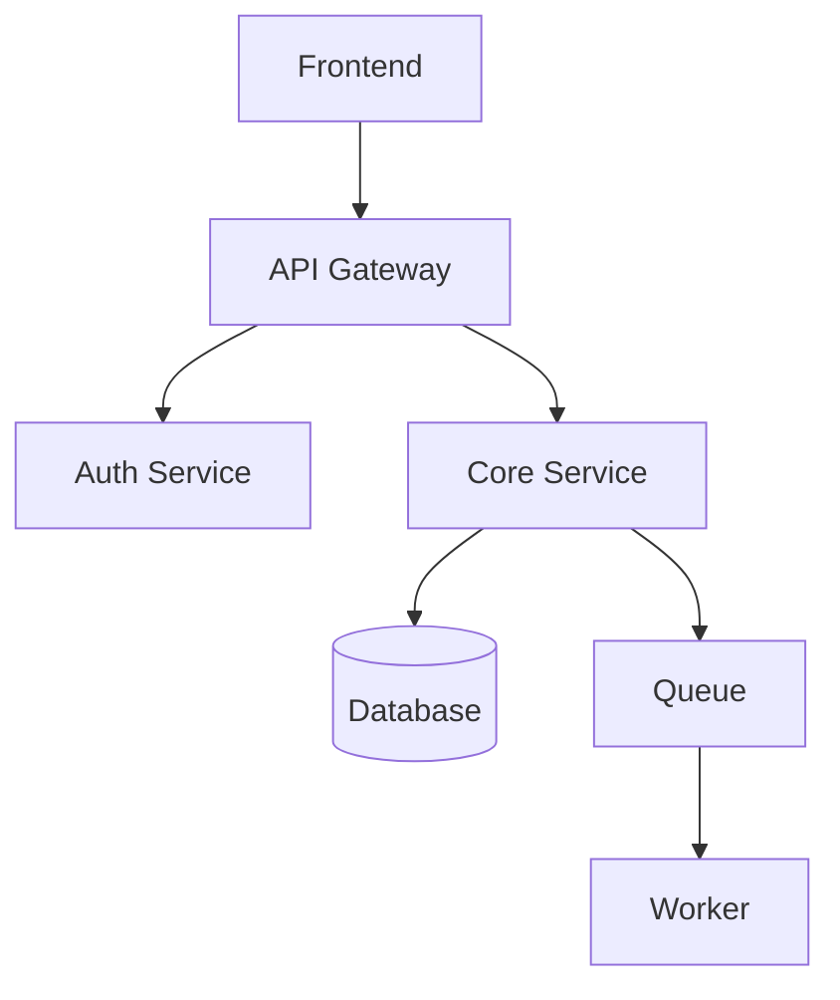

---
this is an example markdown file, used for structure only.
Do not copy and paste this file, follow the pattern and use the sections as relevant. 
---

# Doc Title

Quick doc explanation, medium description

> **Author:** ej8civic  
> **Last Updated:** `YYYY-MM-DD, HH:MM`

 
<!-- Try to use the   tag instead of triple dash "---" or 
 -->

## Context

Brief description of the doc.

 

## Graph / Relation

 

## Tables

| Person  | Role   | When to Contact |
|---------|--------|-----------------|
| Andrey  | senior | 01/02/2027 |
| Laufrey | pleno  | 15/02/2027 |

 

## Checklist

- [x] Repo access transferred
- [ ] Dashboard access granted
- [ ] API keys documented
- [ ] On-call rotation updated

 

## Bullets

- Point 1
- Point 2, exmplanation
- **Point 3**: develop
> Notice

 

## Sources

- Source name: [~/docs/filename.md](~/docs/filename.md)
- Repository: [ej8civic/reponame](https://github.com/ej8civic/reponame)
